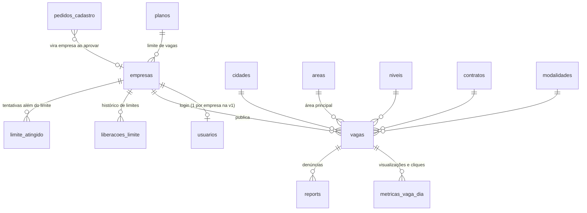

# Fase 1: banco de dados e segurança

O banco da v1 está pronto em `supabase/migrations/`, com Row Level Security (RLS) em todas as tabelas e 75 testes automáticos que conferem quem pode fazer o quê. Este guia mostra como aplicar no seu Supabase, como testar e por que as decisões principais foram tomadas.

## Como as tabelas se ligam



| Tabela | Para que serve |
| --- | --- |
| `planos` | Planos com o limite de vagas no ar. Começa só com "Gratuito" (2 vagas). |
| `cidades`, `areas`, `niveis`, `contratos`, `modalidades` | Listas fixas. Itens nunca são apagados, só desativados. |
| `empresas` | Empresas com login ou sem login (as das vagas curadas). |
| `usuarios` | Liga o login do Supabase ao papel (admin ou empresa). |
| `pedidos_cadastro` | Fila de pré-cadastros. Ao aprovar, vira (ou se liga a) uma empresa. |
| `vagas` | As vagas. Nunca são apagadas. |
| `liberacoes_limite` | Histórico dos limites personalizados: quem, quando, limite, validade, motivo. |
| `limite_atingido` | Cada vez que uma empresa tentou publicar além do limite. |
| `metricas_vaga_dia` | Visualizações e cliques em "Candidatar-se", somados por vaga por dia. |
| `reports` | Denúncias de vagas, avaliadas pelo admin. |
| `vagas_publicas` (visão) | A vitrine: só vagas no ar e só dados públicos. É o que o site público lê. |

## O que mudou em relação ao plano

Três ajustes apareceram ao implementar. Nenhum muda o que o sistema faz para você.

1. **Pré-cadastro numa tabela própria (`pedidos_cadastro`).** Antes ele ia para `empresas` com status "pendente". Separado, o visitante sem login só consegue inserir nessa tabela, um pedido recusado fica guardado e a empresa pode tentar de novo com o mesmo CNPJ (sua resposta 3). Por isso a tabela `vaga_areas_secundarias` deu lugar a ela e o total continua 14.
2. **Áreas secundárias numa coluna de lista da própria vaga**, e não numa tabela à parte. Assim a vaga e as áreas são gravadas juntas, numa operação só, e a regra "até 2, diferentes da principal" fica escrita direto na tabela.
3. **Campos travados por gatilho, e não por permissão de coluna.** O admin e as empresas usam o mesmo papel do PostgreSQL (`authenticated`), e a permissão por coluna não separa os dois. O gatilho consegue: ele confere quem está gravando antes de aceitar a mudança.

## Como aplicar no seu Supabase

1. Crie um projeto em [supabase.com](https://supabase.com) (plano gratuito). Escolha a região São Paulo, que fica mais perto dos usuários.
2. Aplique as migrations. Escolha um dos dois jeitos:
    - **Pelo terminal (recomendado):** na pasta do projeto, rode `npm install`, depois `npx supabase login`, `npx supabase link --project-ref <id do projeto>` (o id está na URL do painel) e `npm run db:push`. O comando pede a senha do banco que você criou com o projeto.
    - **Pelo painel:** abra o SQL Editor e rode cada arquivo de `supabase/migrations/` na ordem dos nomes, um por vez.
3. Em **Authentication > Sign In / Providers**, desligue **Allow new users to sign up**. Ninguém cria conta sozinho: o admin convida a empresa depois de aprovar o pré-cadastro.
4. Confira em **Authentication > Multi-Factor** que o **TOTP** (app autenticador) está ligado. Ele já vem ligado nos projetos novos.

Não coloque a senha do banco nem as chaves do projeto em nenhum arquivo do repositório.

## Como testar

### Os testes automáticos

No SQL Editor, cole o arquivo `supabase/tests/testes_seguranca.sql` inteiro e clique em **Run**. A primeira linha do resultado deve ser:

```
RESUMO: 75 de 75 testes passaram
```

O script cria empresas, usuários e vagas de teste, "entra" como visitante, como empresa A, empresa B e admin, confere o que cada um consegue fazer e no final desfaz tudo. Nenhum dado de teste fica no banco. Se algum teste falhar, a coluna `detalhe` mostra o motivo.

Alguns exemplos do que ele confere:

- a empresa B não vê, não edita e não encerra vagas da empresa A;
- a 3ª vaga no plano gratuito é barrada com a mensagem exata dos requisitos, e a tentativa fica registrada;
- vagas curadas não contam no limite, e o limite personalizado (com validade e motivo) libera mais vagas sem trocar o plano;
- suspender a empresa tira as vagas do ar na hora; reativar devolve as que estão no prazo, até o limite;
- o admin só tem acesso de admin depois da verificação em duas etapas;
- a vitrine não tem e-mail, telefone nem CNPJ;
- excluir a conta apaga e-mail e telefone, remove o login e mantém o nome nas vagas antigas.

Também conferi tudo isso pela API de verdade do Supabase rodando aqui (login com senha, código do app autenticador, upload de logo pelo Storage): 36 de 36 verificações passaram.

### Mexendo você mesmo

No SQL Editor você é o dono do banco, então as travas de empresa não valem ali. Para ver o banco como o site vê, use o **Table Editor** ou estes exemplos:

```sql
-- Cadastrar uma cidade
insert into public.cidades (nome) values ('Pato Branco');

-- Uma empresa sem login e uma vaga curada para ela
insert into public.empresas (nome_fantasia) values ('Empresa Exemplo') returning id;

insert into public.vagas (empresa_id, cargo, area_principal_id, nivel_id, contrato_id,
                          modalidade_id, cidade_id, atividades, requisitos,
                          link_candidatura, encerra_em)
select e.id, 'Analista de Suporte Júnior',
       (select id from public.areas where slug = 'suporte-tecnico-e-help-desk'),
       (select id from public.niveis where slug = 'junior'),
       (select id from public.contratos where slug = 'clt'),
       (select id from public.modalidades where slug = 'presencial'),
       (select id from public.cidades where slug = 'pato-branco'),
       'Atender chamados.', 'Windows e redes.', 'https://exemplo.com.br/vaga',
       current_date + 30
  from public.empresas e where e.nome_fantasia = 'Empresa Exemplo';

-- A vitrine, como o site público vai ler
select slug, cargo, empresa_nome, cidade_nome, modalidade_nome from public.vagas_publicas;
```

Para ver como um visitante, troque o papel no seletor do SQL Editor (onde aparece `postgres`) para `anon` e rode `select * from public.empresas;`. O resultado é um erro de permissão negada, enquanto `select * from public.vagas_publicas;` funciona. Volte o seletor para `postgres` depois.

### Seu usuário de admin (pode ficar para a Fase 4)

Em **Authentication > Users > Add user**, crie seu usuário com e-mail e senha. Copie o **UID** dele e rode:

```sql
insert into public.usuarios (id, papel) values ('<UID copiado>', 'admin');
```

O app autenticador é cadastrado no primeiro login do painel do admin, na Fase 4. Até lá, as permissões de admin pela API ficam bloqueadas, de propósito.

## Aviso que você vai ver no Supabase

O **Security Advisor** do painel deve mostrar o aviso **Security Definer View** para `vagas_publicas`. É esperado. A visão roda com a permissão de quem a criou de propósito: ela mesma é a regra de acesso (só vagas no ar e só colunas públicas). Se ela rodasse com a permissão do visitante, o site público não conseguiria mostrar as vagas, porque o visitante não tem acesso às tabelas.

## Decisões técnicas e o porquê

- **Regras no banco, não só nas telas.** A chave que o site usa é pública: qualquer pessoa consegue copiá-la do navegador e chamar a API direto. Por isso o RLS e os gatilhos garantem as regras mesmo sem passar pelo site.
- **RLS ligado na criação de cada tabela, negando tudo.** Uma tabela sem política não aparece para ninguém. Se uma migration falhar no meio, nada fica exposto.
- **Schema `privado` para as funções auxiliares.** O Supabase publica na API tudo que está em `public`. As funções usadas pelas regras ficam em `privado`, que ninguém chama de fora.
- **`publicar_vaga` captura o erro do limite.** Um erro desfaz tudo o que a operação fez, inclusive o registro de "bateu no limite". A função captura o erro, registra a tentativa e devolve a mensagem para a tela. O gatilho continua barrando qualquer outro caminho.
- **Duas etapas exigidas pelo próprio banco.** O login com o código do app marca o token com `aal2`. As regras de admin conferem essa marca, então a senha sozinha não dá acesso de admin, nem pela API.
- **Datas no horário de Brasília.** O servidor roda em UTC, três horas à frente. Sem esse cuidado, uma vaga que encerra "hoje" sairia do ar às 21h.
- **CNPJ com dígito verificador, inclusive o alfanumérico.** A Receita começou a emitir CNPJs com letras em julho de 2026. O banco já aceita os dois formatos e recusa erros de digitação.
- **Métricas somadas por dia.** Guardar cada clique encheria o banco gratuito. Uma linha por vaga por dia dá o mesmo gráfico para a empresa.
- **Nada é apagado.** Ninguém tem permissão de apagar vagas, nem o admin. Elas mudam de status e ficam para histórico e relatórios.

## Rodando o Supabase no seu computador (opcional)

Precisa do [Docker Desktop](https://www.docker.com/products/docker-desktop/) instalado. Com ele aberto:

```bash
npm install
npm run db:start   # sobe o banco local (a primeira vez demora)
npm run db:reset   # recria o banco com as migrations e os dados de exemplo
npm run db:test    # roda os testes de segurança
npm run db:stop    # desliga
```

## O que fica para as próximas fases

- **Fase 2:** site público lendo `vagas_publicas`, cache na Cloudflare, prévia para WhatsApp e Instagram.
- **Fase 3:** tela de pré-cadastro (com a consulta à BrasilAPI e o aceite dos termos) e painel da empresa.
- **Fase 4:** painel do admin, convite por e-mail ao aprovar, bloqueio do login no Supabase Auth ao suspender, cadastro do app autenticador.
- **Fase 5:** e-mails, checagem de 30 dias com botões de um clique, tarefa que marca vagas vencidas como "expirada" e backup semanal.
